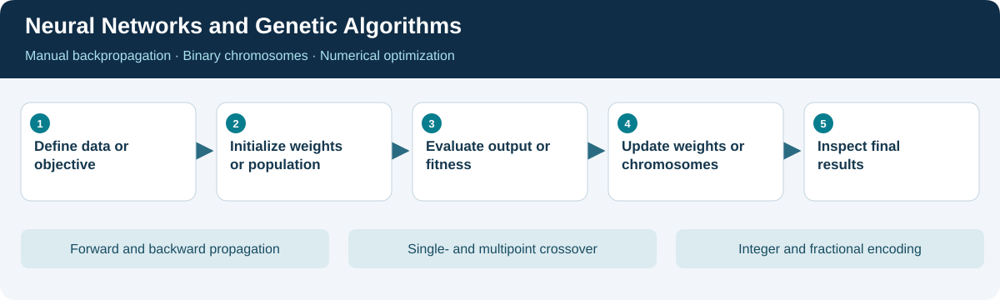
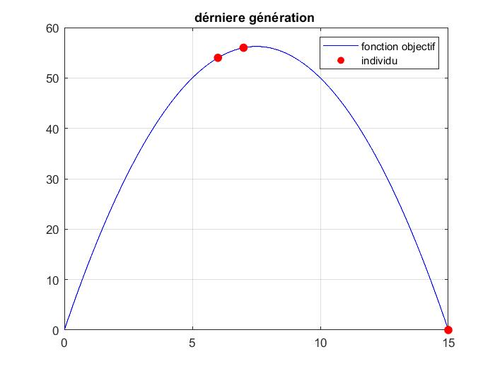
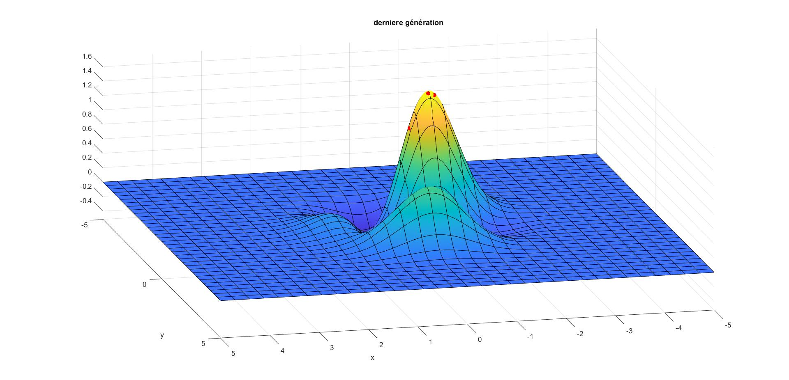

# Neural Networks and Genetic Algorithms

**Manual backpropagation · Binary chromosomes · Numerical optimization**

A set of MATLAB implementations exploring learning and optimization from their basic operations. The project includes a manually implemented multilayer perceptron, genetic algorithms for one- and two-variable objectives, and binary-encoding utilities.

Academic group project at the National Polytechnic School of Algiers.



## Three connected parts

| Part | Purpose | Entry point |
|---|---|---|
| Neural network | Learn an input/output relationship through forward propagation and weight updates | `neural-network/run_neural_network.m` |
| Genetic optimization | Search an objective surface using encoded populations | `genetic-algorithms/run_genetic_algorithms.m` |
| Binary utilities | Represent and manipulate integers, fractions and two’s complement | `binary-encoding/complementDeuxVirguleDemo.m` |

## How the algorithms work

The neural-network example computes neuron activations, compares the output with the target, and propagates the error backward. The gradient-based update has the form:

$$w^{(k+1)}=w^{(k)}-\eta\frac{\partial E}{\partial w}$$

The supplied `datas.m` case defines two inputs, two hidden neurons and one output, with a learning-rate parameter of 1 and a stopping tolerance of 0.005.

The genetic algorithm uses a different strategy. It evaluates a population, selects individuals, crosses their chromosomes and mutates bits before evaluating the next generation. Selection favors fitness, crossover recombines candidates, and mutation introduces new bit patterns.

## Optimization examples

### Single-variable objective

$$f(x)=15x-x^2,\qquad 0\le x\le15$$

The continuous reference maximum is at $x=7.5$, found from $f'(x)=15-2x=0$. The genetic algorithm searches through its binary representation of the domain.

| Setting | Value in `genetic-algorithms/data.m` |
|---|---:|
| Chromosome length | 4 bits |
| Population | 6 individuals |
| Generations | 20 |
| Crossover probability | 0.7 |
| Mutation probability | 0.1 |



### Two-variable search



The second example uses the nonlinear objective defined in `data2.m`, a 16-bit encoding parameter, ten individuals and twenty generations. Its crossover and mutation probabilities are 0.7 and 0.01. The plots show final-population placement on the respective objective curves/surfaces.

## Why implement the operations directly

Separating forward propagation, backpropagation, fitness evaluation, selection, crossover and mutation makes every step inspectable. The binary-conversion exercises support the chromosome representation. Keeping the objective and algorithm settings in data scripts makes it straightforward to compare cases without rewriting the main loop.

## Run an example

Run each entry point from its own folder:

```matlab
cd neural-network
run_neural_network
```

For genetic optimization, open `genetic-algorithms` and run `run_genetic_algorithms`. Choose the objective and crossover method from the menu. For encoding demonstrations, open `binary-encoding` and run `complementDeuxVirguleDemo`.

## Files and tools

| Folder | Contents |
|---|---|
| `neural-network/` | Data, initialization, propagation, learning and output scripts |
| `genetic-algorithms/` | Population operations and one-/two-variable search |
| `binary-encoding/` | Integer, fractional and two’s-complement functions |
| [Algorithm notes](docs/algorithm-notes.md) | Implementation overview and example settings |

**Tools:** MATLAB, numerical arrays, manual learning algorithms and MATLAB plotting.

## Related projects

[Power System Fault Location with Machine Learning](https://github.com/MouaadO/power-system-fault-location-ml) · [Electrical Machine Winding Simulator](https://github.com/MouaadO/electrical-winding-simulator)
