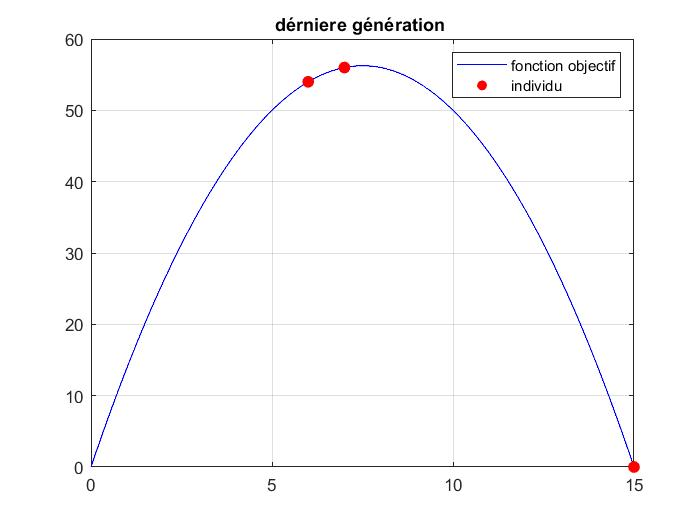
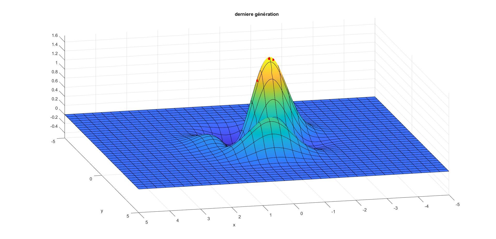

# Neural Networks and Genetic Algorithms in MATLAB

This project covers neural-network training and genetic optimisation in MATLAB, with a manually implemented multilayer perceptron and binary chromosome encoding.

## Main features

- Implements forward propagation and backpropagation for neural-network training.
- Optimizes single-variable and two-variable objective functions.
- Applies selection, mutation and single-point or multipoint crossover.
- Provides binary, fractional and two's-complement conversion utilities.

## Results

The optimisation results are described in the [algorithm notes](docs/algorithm-notes.md).

### Single-variable optimization

The first example maximises `15*x - x^2` over the interval from 0 to 15. The plot shows the final population on the objective curve.

### Two-variable optimization

## Tools

MATLAB, manual backpropagation, binary chromosome encoding and MATLAB plotting.

## Run

Run each example from its corresponding folder:

| Folder | Entry point |
| --- | --- |
| `neural-network/` | `run_neural_network` |
| `genetic-algorithms/` | `run_genetic_algorithms` |
| `binary-encoding/` | `complementDeuxVirguleDemo` |

The genetic-algorithm menu selects the objective and crossover method. The data scripts configure the learning and optimization examples.

Academic group project at the National Polytechnic School of Algiers.
